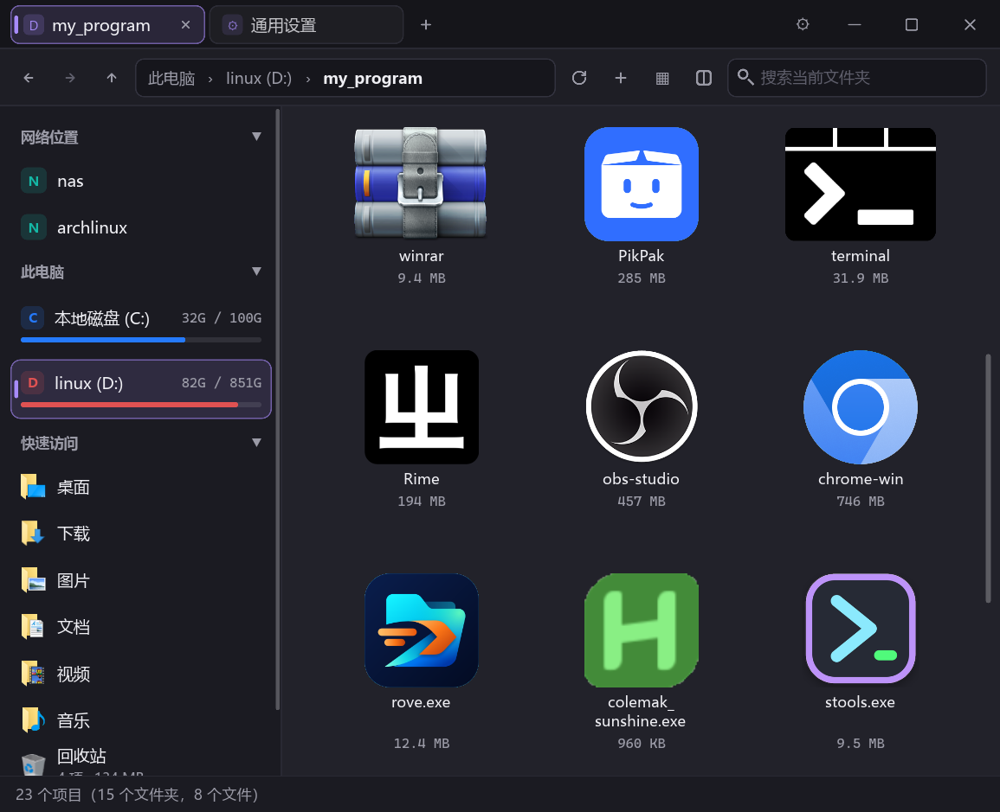

<div align="center">


# Rove

A Windows file manager. 

**one executable, no installer — just run it.**

[中文](README.md)

<p>
  <a href="https://www.rust-lang.org/"></a>
  <a href="https://slint.dev/"></a>
</p>

</div>

---

<p align="center"></p>

## Sponsor

If this project has been useful to you, you can buy the author a coffee ☕️

<details open>
  <summary><b>Click to show the tip QR code (WeChat Pay)</b></summary>
  <br />
  <p align="center">
    
    <br />
  </p>
  <p align="center">Thank you for your support! Your name will be recorded in the <a href="https://github.com/cap153/rove/blob/main/.github/SPONSOR.md#-%E6%84%9F%E8%B0%A2%E5%90%8D%E5%8D%95-backers">list of backers</a>.</p>
</details>

---

## 1. Tabs, plus a left/right split

Tabs work like a browser. Any tab can be split into two panes showing two different folders, and you can drag files (or whole folders) from one side to the other.

When split, `Ctrl+W` closes the right pane first, and a second press closes the tab.

With many tabs open, put the mouse wheel over the tab bar to scroll it sideways; an address bar whose path is too long scrolls the same way.

Closing the window (the × button) saves the tabs as they are — every tab, its split panes, the folder in each pane and the active one — and they come back on the next launch.

If instead you end the session with **Close all** in the tab bar's right-click menu, or by closing the last tab, the next launch opens a single This PC tab. **Settings → General → Startup with** can make This PC the default instead.

## 2. Instant whole-disk search: just type on the "This PC" page

Type any name into the search box on the **This PC** page and Rove looks through **all your drives**, without clicking into folders one by one. Chinese names also match by pinyin (`jsq` or `jisuanqi` finds `计算器`).

It is fast because of an **index**. In plain words: while the app is idle it writes down "which file/folder lives at which path" into one list and saves that list on disk. Searching then only reads that list instead of walking every directory. Concretely:

- the list is built quietly in the background and cached, so the next launch reuses it;
- with administrator rights it reads the NTFS file table directly, which is an order of magnitude faster than a normal walk; without them it walks normally — same results, slower;
- the "sync index while idle" option refreshes it in the background, so it does not go stale;
- the **first** run has to scan your drives (tens of seconds to a few minutes, depending on file count). You can keep using the app meanwhile; the status bar reports progress.

Which drives and paths take part is configurable under **Settings → Search & Index**.

Typing inside an **ordinary folder** does something else: it filters the current folder immediately and also starts searching its subfolders in the background; results stream in as they are found.

## 3. The pop-up search bar next to Open / Save dialogs

Finding a folder inside a Windows Open or Save dialog normally means clicking through levels. While Rove is running it docks a small search box next to those dialogs: type a folder name, press Enter or click the result, and the dialog jumps there.

It only types the path into the dialog for you — it does not take over the dialog's buttons, and nothing leaves your machine. This keeps working when the main window is closed and Rove is sitting in the tray.

> [!CAUTION]
> Only the standard Windows Open/Save dialogs are supported.

## 4. Staging tray: collect first, move once

Right-click **Add to staging tray** to gather files from different folders into the tray in the sidebar, then walk to the destination and hit **Copy here** or **Move here** once. Collecting across tabs works too.

## 5. Batch rename

Select a batch of files → right-click → **Batch rename**:

- plain-text replacement or regular expressions; apply to file name, extension, or both;
- the right side is a **live preview**: you see exactly what each file will become before anything happens, and which rows would fail (duplicate names, illegal characters, reserved names, name too long);
- nothing is touched until you confirm, and rows that cannot be renamed are left alone.

## 6. Configure the context menu yourself

Under **Settings → Context menu** you can:

- toggle built-in items on and off;
- hide unwanted system menu items by keyword;
- add your own actions: a program path plus an argument template (for example `"{path}"`), optionally limited to extensions such as `txt, md`, optionally placed in a submenu.

## 7. Rove can take over Explorer — and give it back

Turn on **Take over Explorer** and double-clicking a folder, a drive, or This PC opens it in Rove instead (in a new tab, inside the window that is already open).

It only writes the current user's registry (`HKCU`), needs no administrator rights, and turning the switch off restores the previous values exactly as they were. Settings you changed yourself afterwards are never overwritten.

## 8. Background resident, autostart, single instance

- Autostart starts Rove **in the background**: no window at login, only a tray icon, with the dialog search bar and a warm index ready to go. (It uses a Run-key entry, not a shortcut in the Startup folder.)
- Running `rove.exe` a second time, or using "open file location" from elsewhere, does not start a second process — it opens a new tab in the window you already have.

## 9. Smaller differences worth knowing

- **`Ctrl+Z` undoes and `Ctrl+Y` redoes the last file operation** (copy, move, rename, new folder, delete to the Recycle Bin). Undo only knows about operations Rove itself performed, so files deleted by other programs cannot be undone; a batch rename is reverted as one step.
- **Almost every shortcut is rebindable,** and you can add extra bindings per action, with per-item or global reset to defaults. (`Esc` to clear the filter is fixed.)
- **Sort state is kept separately** for This PC, the Recycle Bin, and normal folders, so they never leak into each other. (There is no grouping.)
- Thumbnails for images, videos and PDFs are cached in **memory and on disk**, so large folders stay smooth. (Network paths are not cached.)
- Detail-view column widths can be dragged; icon view has extra-large / large / medium / small sizes.
- Hidden-file toggle, invert selection, copy path, open a terminal (cmd) here, pin to Quick Access.
- Network locations are synced with the ones added in Explorer; you can also add your own by right-clicking the sidebar header.

## Where the data lives

| What | Where |
| --- | --- |
| Settings, network locations | `%APPDATA%\Rove\config.json` |
| Context-menu actions (hand-editable, comments kept) | `%APPDATA%\Rove\actions.toml` |
| Search index | `%LOCALAPPDATA%\Rove\index.bin` |
| Registry backup taken before Explorer takeover | `%APPDATA%\Rove\shell_integration.json` |

Deleting these files resets Rove to a fresh state. (Turning off Explorer takeover or autostart deletes the corresponding registry values automatically.)

## Building

Requires a Rust toolchain.

```bash
# on Windows
cargo build --release
```

The result is a single `rove.exe` that runs from anywhere.

## Startup failure / no window

Rove falls back to CPU software rendering by itself when hardware rendering fails to initialize; if that is still not enough, set it by hand:

```bat
set SLINT_BACKEND=winit-software
rove.exe
```

To force the GPU instead, use `set SLINT_BACKEND=winit-femtovg`.

## Known limitations

- Only tested on Windows 10, 64-bit.
- Global search matches **file and folder names** only, not file contents.
- Dragging files to copy them onto the desktop blocks the UI; for large files use `Ctrl+C` / `Ctrl+V` instead.
- By default, indexing covers only local solid-state drives (HDDs can be included by enabling them in the settings); network drives and removable drives are not indexed.
- Explorer takeover only changes the current user's settings, so it may fight with other tools of the same kind.
- If the window was maximized when you last closed Rove, a brief white flash appears on startup or when waking from the tray.

## License

MIT

## References & Credits

Ideas for the interface and interactions were borrowed from these projects — thanks to their authors:

| Project | What was referenced |
| --- | --- |
| [PowerToys](https://github.com/microsoft/PowerToys) | Layout and interaction of the batch-rename window (PowerRename) |
| [pulse](https://github.com/jimmgreen/pulse) | Taking over Explorer via `IShellWindows` self-registration, the docked dialog search bar, and the sidebar drive-capacity display |
| [zsdesk](https://github.com/qiu7824/zsdesk) | System context menu, and research into a multi-tab Win32/COM implementation (Rove does not use its DLL-injection Explorer takeover) |
| [sigma-file-manager](https://github.com/aleksey-hoffman/sigma-file-manager) | Interface organisation, how information is presented, and the search index |
| [disktree](https://github.com/tobi/disktree) | Ideas for visualising disk capacity |
| [stools](https://github.com/cap153/stools) | A launcher by the same author; practical experience with pinyin search, Slint windows and shortcut handling |
