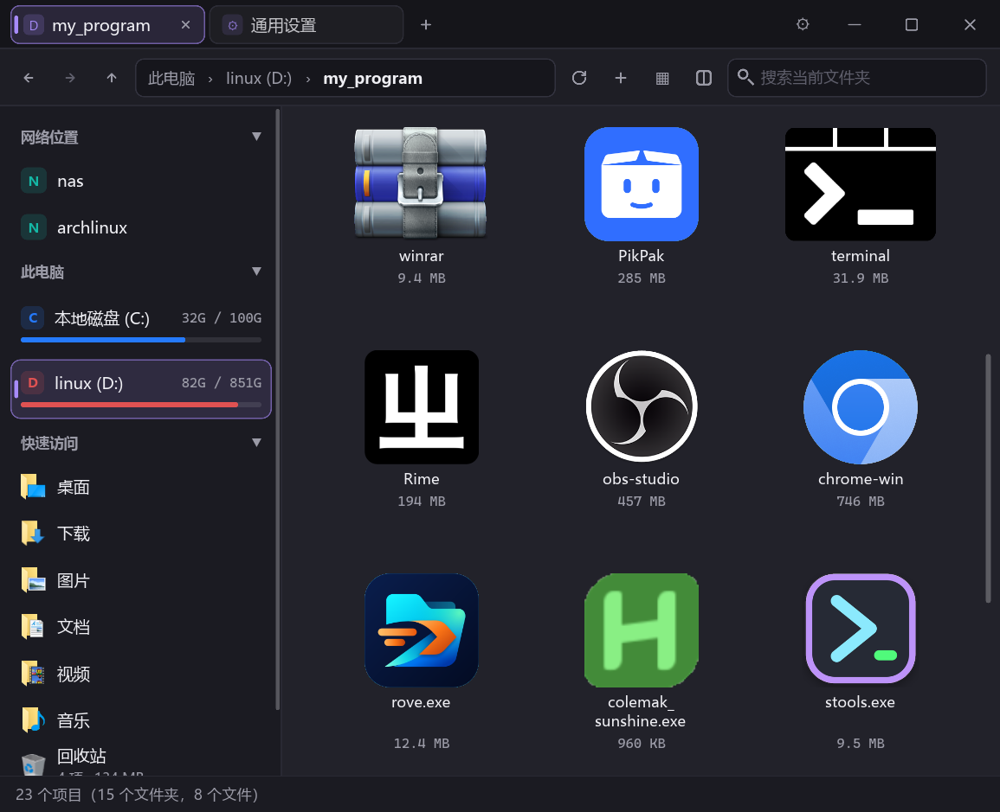

<div align="center">


# Rove

一个 Windows 文件管理器。

**单文件、绿色免安装，双击就能用。**

[English](README.en.md)

<p>
  <a href="https://www.rust-lang.org/"></a>
  <a href="https://slint.dev/"></a>
</p>

</div>

---

<p align="center"></p>

## 赞助

如果你觉得这个项目对你有帮助，可以请作者喝杯咖啡 ☕️

<details open>
  <summary><b>点击折叠赞赏码 (WeChat Pay)</b></summary>
  <br />
  <p align="center">
    
    <br />
  </p>
  <p align="center">感谢您的支持！您的名字将被记录在 <a href="https://github.com/cap153/rove/blob/main/.github/SPONSOR.md#-%E6%84%9F%E8%B0%A2%E5%90%8D%E5%8D%95-backers">赞助者名单</a> 中。</p>
</details>

---

## 1. 标签页 + 左右分屏

标签页和浏览器一样用，每个标签还能再左右分成两块，两边各看一个目录。文件可以从一边拖到另一边（也可以在两边之间拖整个文件夹）。

分屏时按 `Ctrl+W` 先把右分屏关闭，再按一次才关标签。

标签开得多了，把滚轮放在标签栏上就能横向滚过去；地址栏的路径太长时也一样，滚轮可以把整条路径左右挪动。

关窗口（右上角 ×）时，当前标签会存下来：每个标签、各自的分屏、每栏的目录、当前活动的那一栏，下次启动原样回来。

但如果你是用标签栏右键菜单里的「关闭全部」结束，或者把最后一个标签关掉，下次将只开一个「此电脑」。**「设置 → 通用 → 启动时打开」可以把默认行为改成每次都开「电脑选项」。**

## 2. 全盘秒搜：在「此电脑」里直接打字

在「此电脑」这一页的搜索框里输入任何名字，它会去**所有硬盘**里找，不用一层层点进去。中文名还能用拼音找（`jsq`、`jisuanqi` 都能找到 `计算器`）。

它快的原理是**索引**：平时先把「哪个文件 / 文件夹在哪个路径」抄成一份清单存到硬盘上，搜索时只查这份清单，而不是临场去翻每一个目录。所以：

- 清单在后台悄悄生成，生成完存成文件，下次打开直接复用；
- 有管理员权限时会直接读 NTFS 的文件表，比普通遍历快一个数量级；没有就普通遍历，慢一些但结果一样；
- 「空闲时自动同步索引」会在你用别的东西时补一遍变化，所以清单不会一直陈旧；
- **第一次**要扫一遍盘（几十秒到几分钟，取决于文件数量），这期间可以正常使用，状态栏会告诉你进度。

搜索范围（哪些盘、哪些路径不参与）在「设置 → 搜索与索引」里调。

在**普通文件夹**里打字，搜索框做的是另一件事：先筛当前目录，同时自动往子文件夹里再找一遍，结果会陆续并进来。

## 3. 吸附窗：在「打开 / 另存为」对话框旁边搜文件夹

Windows 的打开、另存为对话框里找一个文件夹要一层层点。Rove 在后台运行时，会自动在这些对话框旁边贴一条搜索框：输入文件夹名字，点一下 / 回车，对话框就跳过去了。

它只是替你输入路径，不接管对话框本身的按钮，也没有任何数据离开你的机器。Rove 关掉窗口（但托盘常驻）时这个功能照样工作。

> [!Caution]
> 只对系统自带的打开/另存为对话框有效。

## 4. 暂存盘：先攒着，最后一并搬

右键「添加到暂存盘」，能把不同目录里的文件先收进侧边栏那块暂存区；走到目标目录后点「复制到此处」或「移动到此处」一次完成。跨标签收集也支持。

## 5. 批量重命名

选中一批文件 → 右键「批量重命名」：

- 要么纯文本替换，要么正则替换；可以只作用于文件名、只作用于扩展名，或两者都改；
- 右边是**实时预览**，改名前就能看到每一个会变成什么，以及哪几条会失败（重名、非法字符、系统保留名、名字过长）；
- 你确认才开始改，改不了的一条都不会动。

## 6. 右键菜单由你配置

「设置 → 右键菜单」里可以：

- 开关内置菜单项；
- 用关键词把不想要的系统菜单项藏起来；
- 新增自己的动作：填程序路径 + 参数模板（比如 `"{path}"`，也可以只对 `txt, md` 这类扩展名显示），还能归进二级菜单。

## 7. 可以接管资源管理器，也能随时退回去

打开「接管资源管理器」后，双击文件夹、磁盘、此电脑都会用 Rove 打开（新开标签，并合到已经开着的那个窗口里）。

只写当前用户的注册表（`HKCU`），不需要管理员权限；关掉开关会按写入前的原样还原，不会动你后来自己改过的设置。

## 8. 后台常驻、开机自启、单实例

- 开机自启是**后台常驻**：登录后只留托盘，不弹窗口，吸附窗和索引预热立即可用（用的是注册表的 Run 项，不是启动文件夹里的快捷方式）。
- 再次双击 `rove.exe`，或从别处「打开文件所在位置」，不会开第二个进程，而是直接在已开的窗口里开新标签。
- **低内存模式** 开关(默认开启) ：「关窗到托盘」时释放全盘索引的映射、把工作集还给系统，**托盘常驻的内存从上百 MB 降到个位数 MB**（代价是下次唤出时那一帧要重新换入，稍微慢一点）

## 9. 一些顺手的小差别

- **`Ctrl+Z` 撤消 / `Ctrl+Y` 重做最近一次文件操作**（复制、移动、重命名、新建、删除到回收站）。撤消只认 Rove 自己做的操作，别的程序删的文件撤不了；大批量重命名也能一次整体改回去。
- **快捷键基本都能改，** 还能给同一动作加备用键，可单项或全部恢复默认。（`Esc` 清空筛选是固定的）
- **排序状态三处各自独立**：此电脑、回收站、普通文件夹互不影响。（没有分组功能）
- 图片、视频、PDF 的**缩略图有内存 + 磁盘缓存**，翻大目录不卡。（网络路径不会缓存）
- 网络位置会自动同步资源管理器添加过的，也可以在侧边栏右键标题手动添加。
- 侧边栏的`此电脑`处鼠标右键可以自定义侧边栏

## 数据放在哪

| 内容                               | 位置                                    |
|------------------------------------|-----------------------------------------|
| 设置、网络位置                     | `%APPDATA%\Rove\config.json`            |
| 右键菜单动作（可手改，注释会保留） | `%APPDATA%\Rove\actions.toml`           |
| 搜索结果索引                       | `%LOCALAPPDATA%\Rove\index.bin`         |
| 「独立视图和排序」开启时的记忆     | `%APPDATA%\Rove\views.json`             |
| 接管前的注册表备份                 | `%APPDATA%\Rove\shell_integration.json` |

删掉这些文件等于恢复出初始状态。（接管资源管理器、开机自启动开关关闭后自动删除对应注册表）

## 构建

需要 Rust 工具链。

```bash
# Windows 本机
cargo build --release
```

产物是单个 `rove.exe`，复制到哪都能跑。

仓库里带了 `justfile`，装了 [just](https://github.com/casey/just) 之后不用记长命令：

```bash
just        # 不带参数 = 列出可用命令
just rel    # femtovg（OpenGL）release 构建
just skia   # Skia（Direct3D 12）release 构建
```

`just skia` 需要在 Linux/WSL 上交叉编译 msvc 目标：

```bash
sudo pacman -S --needed clang lld llvm   # 其它发行版换成对应的包
rustup target add x86_64-pc-windows-msvc
cargo install cargo-xwin --locked
```

## 启动失败 / 窗口不出来

Rove 在硬件渲染初始化失败时会自动切 CPU 软件渲染，若仍然不行，手动指定：

```bat
set SLINT_BACKEND=winit-software
rove.exe
```

反过来强制走 GPU 就是 `set SLINT_BACKEND=winit-femtovg`。

## 已知限制

- 只测试过 Windows 10，64 位。
- 全局搜索只匹配**文件/文件夹名称**，不搜文件内容。
- 拖动文件复制到桌面时会阻塞界面，大文件建议改用 `Ctrl+C` / `Ctrl+V`。
- 默认索引只覆盖本地固态硬盘（机械硬盘可自行前往设置页开启）；网络盘、移动盘不进索引。
- 接管资源管理器只改当前用户设置，如果装了别的同类接管工具，可能互相覆盖。
- 如果上次关闭时窗口是最大化的，启动或从托盘唤起那一刻会有短暂白闪。

## 许可

MIT

## 参考与致谢

界面与交互上参考过这些项目，也在这里说声谢谢：

| 项目                                                                        | 参考了                                                                                  |
|-----------------------------------------------------------------------------|-----------------------------------------------------------------------------------------|
| [PowerToys](https://github.com/microsoft/PowerToys)                         | 批量重命名的界面布局与交互（PowerRename）                                               |
| [pulse](https://github.com/jimmgreen/pulse)                                 | 接管资源管理器的思路（`IShellWindows` 自注册）、吸附窗贴边定位、侧栏磁盘容量的显示样式  |
| [zsdesk](https://github.com/qiu7824/zsdesk)                                 | 系统右键菜单、多标签 + Win32/COM 的实现路线调研（Rove 没有采用 DLL 注入接管资源管理器） |
| [sigma-file-manager](https://github.com/aleksey-hoffman/sigma-file-manager) | 文件管理器的界面组织与信息呈现、搜索索引                                                |
| [disktree](https://github.com/tobi/disktree)                                | 磁盘容量可视化的思路                                                                    |
| [stools](https://github.com/cap153/stools)                                  | 同作者的启动器，拼音搜索、Slint 窗口与快捷键处理的实践经验                              |
